<div align="center">

<picture>
  <source media="(prefers-color-scheme: dark)" srcset=".github/assets/banner-dark.svg">
  
</picture>

**Start with production structure, not an empty directory.**<br>
The structured API starter with typed DTOs, thin controllers, services, repositories, resources, migrations, tests, and integer-backed domain enums.

[](https://packagist.org/packages/pushinbr/pam-skeleton)

[](LICENSE)

[Install](#install) · [Quick example](#quick-example) · [What you get](#what-you-get) · [Docs](#docs) · [Issues](https://github.com/push-in/pam-skeleton/issues)

</div>

<a id="install"></a>
## <picture></picture> Install

Create a project from the skeleton with PAM's embedded Composer:

```sh
pam composer create-project pushinbr/pam-skeleton my-app
cd my-app
pam composer require illuminate/database illuminate/events illuminate/filesystem illuminate/pagination
pam doctor --fix
pam dev
```

The starter's database layer uses PAM HTTP's optional Eloquent bridge, whose `illuminate/*` packages are installed separately (see the [PAM HTTP guide](https://github.com/push-in/pam-http/blob/main/docs/guide.md#eloquent-orm-optional)). `.env.example` defaults to SQLite (`DB_CONNECTION=sqlite`, `DB_DATABASE=storage/database.sqlite`) on port 3000; `bin/migrate` runs the migrations and `pam test` runs the suite.

For a minimal API without the layered structure, `pam init my-api --template http` scaffolds a single `index.php` with the same `pushinbr/pam-http` 2.x router.

<a id="quick-example"></a>
## <picture></picture> Quick example

```php
<?php

declare(strict_types=1);

use App\Http\Controllers\PingController;
use App\Http\Controllers\ProductController;
use App\Providers\AppServiceProvider;
use Pam\Api\Config\ConfigDefinition;
use Pam\Api\Config\Configuration;
use Pam\Api\Config\ConfigType;
use Pam\Api\Middleware\SecurityHeadersMiddleware;
use Pam\Api\Database\DatabaseConfig;
use Pam\Api\Database\EloquentServiceProvider;
use Pam\App;

$config = Configuration::fromEnvironment([
    new ConfigDefinition(
        key: 'app.port',
        environment: 'PAM_PORT',
        type: ConfigType::Integer,
        required: false,
        default: 3000,
    ),
]);
$app = new App();
$app->provider(new EloquentServiceProvider(DatabaseConfig::fromEnvironment()));
$app->provider(new AppServiceProvider());
$app->middleware(new SecurityHeadersMiddleware());
$app->get('/api/ping', [PingController::class, 'show']);
$app->get('/api/products', [ProductController::class, 'index']);
$app->post('/api/products', [ProductController::class, 'store']);
$app->listen($config->integer('app.port'));
```

Routes call thin controllers (`src/Http/Controllers`), which delegate to services and repositories; `ProductStatus` is an integer-backed enum (`Active = 1`, `Archived = 2`).

<a id="what-you-get"></a>
## <picture></picture> What you get

- Starting a structured JSON API
- Teaching the recommended PAM application architecture
- Proving database, validation, resource, and test workflows end to end

| | |
| --- | --- |
| **Role** | Application starter |
| **Execution path** | PAM HTTP · Eloquent · PHP 8.5 |
| **This repository owns** | Generated project structure and first executable vertical slice |
| **Boundary** | A starting point, not a framework dependency or runtime distribution |

```text
src/
  Domain/Products/      CreateProductData, ProductStatus
  Http/Controllers/     PingController, ProductController
  Http/Requests/        StoreProductRequest
  Http/Resources/       PingResource, ProductResource
  Models/               Product
  Providers/            AppServiceProvider
  Repositories/         ProductRepository, EloquentProductRepository
  Services/             ProductService, ReadinessService
database/migrations/    create_products
tests/                  ApplicationTest
```

<a id="docs"></a>
## <picture></picture> Docs

- [Your first app](https://push-in.github.io/pam-docs/getting-started/first-app/)
- [PAM HTTP](https://github.com/push-in/pam-http)
- [Changelog](CHANGELOG.md)

<a id="pam-ecosystem"></a>
## <picture></picture> Part of the PAM ecosystem

PAM runs PHP natively on servers, desktops and phones. This repository is one piece of it.

| [**PAM**](https://github.com/push-in/pam) | [**PAM Desktop**](https://github.com/push-in/pam-desktop) | [**PAM Native**](https://github.com/push-in/pam-native) | [**Ecosystem**](https://github.com/push-in/pam#ecosystem) |
| --- | --- | --- | --- |
| the runtime and CLI | native desktop apps in PHP | native Android and iOS apps in PHP | every official package and plugin |

<sub>Docs: [push-in.github.io/pam-docs](https://push-in.github.io/pam-docs/introduction/) · [Issues](https://github.com/push-in/pam-skeleton/issues)</sub>

<p align="center"><sub><a href="LICENSE">Apache License 2.0</a> with an Additional Use Grant: files copied from this skeleton and code emitted by PAM generators may be used, modified, sublicensed and distributed under terms of your choice · Made in Brazil by Pushin</sub></p>
